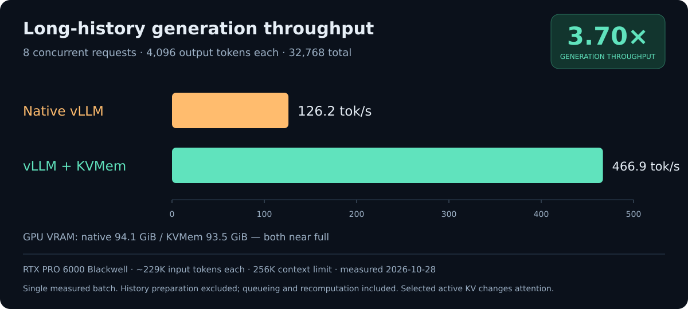

# Benchmarks

## Long-history generation throughput

On one RTX PRO 6000 Blackwell Server Edition, KVMem delivered **3.70× the
aggregate generation throughput of native vLLM** in one measured batch of eight
long-history requests. Each request used approximately 229K input tokens and
generated 4,096 output tokens. Both servers had a 262,144-token context limit
and used nearly all available GPU memory.



| Measurement | Native vLLM | vLLM + KVMem |
| --- | ---: | ---: |
| Aggregate generation throughput | 126.16 output tokens/s | 466.85 output tokens/s |
| Time for all eight continuations | 259.73 s | 70.19 s |
| Output tokens per request | 4,096 | 4,096 |
| Total output tokens | 32,768 | 32,768 |
| Measured GPU memory during generation | 94.06 GiB | 93.53 GiB |
| Configured `gpu_memory_utilization` | 0.95 | 0.90 |
| Preemptions during generation | 1 | 0 |

The result was measured on **2026-10-28**. Exact numbers, input-token hashes,
model revision, software versions and evidence hashes are in the
[portable result summary](benchmarks/deepswe-long-history-20261028.json).
The figure contains aggregate measurements only; it does not redistribute
benchmark prompts or generated task text.

### What “generation throughput” means

```text
aggregate generation throughput = 32,768 accepted output tokens
                                  / elapsed continuation-batch seconds
```

Timing begins when the eight continuation requests are submitted and ends after
the final response. It includes scheduling waits, prefix recovery and any
recomputation that occurs during those requests. Initial model loading,
compilation, warmup and preparation of the long histories are excluded.
This is a serving measurement, not a pure decoder-kernel rate.

The workload replays **eight distinct, complete recorded histories from four
real DeepSWE tasks, two turns per task**. Inputs range from 228,827 to 230,102
tokens; they are neither padded to 256K nor truncated. The source token IDs and
recorded continuation token are identical between backends. A fixed quota with
`ignore_eos=true` makes each request generate exactly 4,096 tokens. These
continuations do not execute new tools or establish task-solving accuracy.

### Configuration and comparison

| Component | Recorded setting |
| --- | --- |
| GPU | 1 × NVIDIA RTX PRO 6000 Blackwell Server Edition, 95.59 GiB reported device memory |
| Model | [NVIDIA Qwen3.8-27B-NVFP4](https://huggingface.co/nvidia/Qwen3.8-27B-NVFP4/tree/482ca0f3832238542f8f5295dde86b5f22711d80), revision `482ca0f3832238542f8f5295dde86b5f22711d80` |
| Model architecture | `Qwen3_5ForConditionalGeneration`; mixed NVFP4/FP8 weights |
| Tokenizer | [Qwen/Qwen3.8-27B](https://huggingface.co/Qwen/Qwen3.8-27B/tree/1d4bf0f2ff6012fd82039f2fa52739d0dd7c60c0), the existing BF16 tokenizer; exact file hashes in the summary |
| Runtime | vLLM 0.30.0; PyTorch 2.13.0+cu130; FlashInfer 0.6.18.post1 |
| KV / execution | FP8 E4M3 KV; BF16 activations; compiled CUDA Graph execution |
| Speculative decoding | Native MTP, four draft tokens |
| Limits | Eight sequences; 262,144-token logical context; effective batch budget 16,424; ordinary prefill chunks 2,048 |
| KVMem window | K = 98,304 selected tokens; G = 16,384 growth reserve |
| History / selection | CPU archive with a 100,000,000,000-byte budget; 50/50 MeanK and key-FPS4 selection; history GC disabled |

The [256K MTP serving profile](../examples/serve-qwen-mtp-256k.json) is derived
from this run for a 96 GiB-class GPU and a host with approximately 125 GiB RAM.
It contains editable model paths. Running that profile against current source
is not an exact reproduction of the frozen benchmark runtime.

Native vLLM ran directly with KVMem plugins disabled, native asynchronous
scheduling and prefix caching. KVMem retained complete histories on the CPU and
restored selected KV into its bounded GPU working window. The audit observed
813 decode steps with eight KVMem requests in the model batch, active lengths
at most 114,656 tokens per request, and no KV disk reads or writes.

**This comparison includes selective attention.** Native vLLM attends to its
full retained context; KVMem attends to the selected active window. CPU history
retention does not make their numerical computations equivalent. The throughput
result does not demonstrate unchanged task quality or a speedup from lossless
CPU offload alone.

The two memory fractions differ because their additional GPU allocations differ.
The comparison targets **near-full measured physical memory** on each backend,
not equal allocation flags. Actual usage was sampled through NVML v2 once per
second, excluding driver-reserved bytes. The recorded fractions are settings for
this machine and workload, not suggested defaults for every GPU.

The backends ran sequentially on the same GPU with the same inputs and output
quota. This is one completed batch per backend, not a repeated statistical
study, an open-loop saturation test, or a maximum sustainable QPS claim. Earlier
results using a 0.72 allocation budget are different experiments and should not
replace this near-full-memory comparison.

## Reproducing and auditing a run

The repository includes the harness and validators. Exact reproduction also
requires the original input-token exports, compatible model/tokenizer files and
a prepared campaign containing a frozen runtime. Those experiment artifacts are
not included in a source checkout. The portable JSON summary records their
identifiers and selected hashes; it is not a replacement for the raw evidence.

After [installing the runtime](installation.md), inspect the harness before
preparing your own dataset and campaign:

```sh
.venv/bin/python scripts/benchmark_deepswe_qps_replay.py --help
.venv/bin/python scripts/audit_deepswe_stream.py --help
```

The replay runner uses `httpx`, `psutil` and `nvidia-ml-py` (imported as
`pynvml`) for streaming, process ownership and GPU telemetry. For a new campaign,
install any missing helpers **before** freezing its environment:

```sh
uv pip install --python .venv/bin/python httpx psutil nvidia-ml-py
```

Use the same Python environment that created the campaign. The runner checks
the recorded interpreter and dependency versions before starting either backend;
calling another virtual environment, even one with the same Python version,
does not satisfy that requirement. The commands below assume the campaign used
`.venv/bin/python`. A frozen campaign also contains absolute model, runtime and
source-data paths: copying its directory alone does not relocate those inputs.

With a completed, compatible frozen campaign and an eight-history export already
available, the experiment workflow is:

```sh
benchmark_dir=artifacts/deepswe-long-history
.venv/bin/python scripts/benchmark_deepswe_qps_replay.py prepare \
  --campaign /path/to/completed-campaign \
  --history /path/to/eight-history-export \
  --output "$benchmark_dir" \
  --stream --telemetry \
  --native-gpu-memory-utilization 0.95 \
  --kvmem-gpu-memory-utilization 0.90 \
  --memory-policy near-full-physical
.venv/bin/python "$benchmark_dir/run.py" run --output "$benchmark_dir"
.venv/bin/python scripts/audit_deepswe_stream.py "$benchmark_dir"
```

The preparation step validates source hashes and copies the runner, profiles and
input tokens. Running a benchmark requires an unused GPU and the matching
runtime environment. Use a new output directory for each attempt; failed or
interrupted attempts remain evidence and are not implicitly retried.

The audit reconciles input hashes, streamed token IDs and text, final usage,
server counters, timing, CPU history retention, GPU sampling and process cleanup.
For a shareable result, retain the run manifest, summaries, audit report and
configuration alongside the measurements. State the input lengths, output quota,
attention policy, timing boundaries and number of completed repetitions.

## Other experiments

Dated reports under `docs/` retain earlier engineering experiments and their own
qualification limits. They can refer to local artifacts that are not distributed
in this repository. Use the recorded configuration and scope of each report;
do not combine results from different context sizes, memory budgets or workloads
into one speedup claim. The [executed-agent harness](../benchmarks/deepswe/README.md)
measures a separate workload and has additional dataset, container and verifier
requirements.
