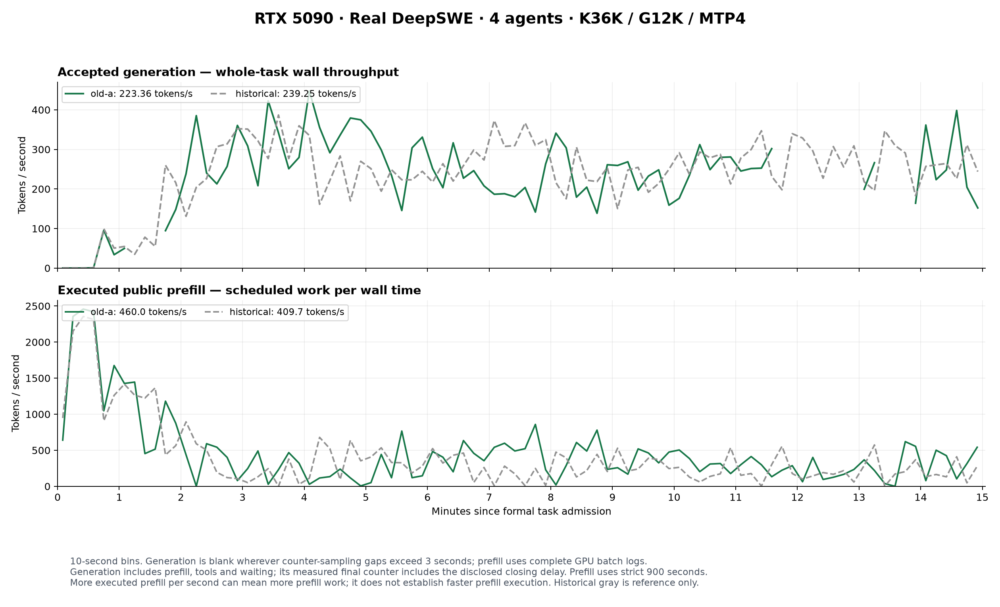

# RTX 5090: active-KV handoff with four GPU request slots

**Status: testing is paused at the user's request; the RTX 5090 is powered off.**
The [four-agent regression investigation](#four-agent-regression-investigation-paused)
has three completed observations and an interrupted latest current-code arm.
The regression cause remains unresolved; no new optimization has completed GPU
performance validation.

The subsequent tool-return grace experiment is documented below under
[Adaptive tool-return grace](#adaptive-tool-return-grace). Its fresh baseline
and candidate disable detailed host/restore tracing; do not use the earlier
155.04 tokens/s instrumented result as that experiment's denominator.

On 2026-10-31, an assembly configuration/code variant showed **41.1% higher
instrumented real DeepSWE generation throughput (1.41×)** in one pair
of 15-minute windows. Mean cold-restore latency was 65.0% lower. These are
observations of the combined variant, not an isolated metadata-batching effect;
see the corrected path attribution below.
The workload used eight agents sharing four GPU request slots, so tool calls
could be overlapped with other requests and idle KV pages could be replaced.

These are actual agent runs with tools and natural EOS. They are separate from
the [earlier four-agent native-vLLM comparison](benchmarks.md#real-deepswe-agents-on-rtx-5090).
Both arms include the same host tracing; this pair does not establish an
uninstrumented production speedup, maximum QPS or task-solving-quality gain.

## Measured result

| Measurement | Baseline | Combined variant |
| --- | ---: | ---: |
| Accepted generation tokens/s | 109.89 | 155.04 |
| Accepted generated tokens | 99,045 | 139,585 |
| Completed model turns | 251 | 290 |
| Model-turn QPS | 0.2789 | 0.3222 |
| Real tool results | 372 | 364 |
| Completed whole tasks | 0 | 0 |
| Measured-window peak GPU memory, used + reserved | 31.324 GiB | 31.345 GiB |
| All-phase peak, including capacity qualification | 31.794 GiB | 31.802 GiB |
| Request errors / preemptions | 0 / 0 | 0 / 0 |

Generation counts include accepted tokens from calls still running at the
cutoff. Their denominator is the actual counter-sampling interval
(901.331 and 900.329 seconds), including prefill,
tools, restores and waiting. Model-turn QPS counts only calls completed by the
900-second deadline; its observed ratio is 1.16×. Unfinished task
workspaces are preserved and unscored, rather than counted as solved or failed.

The GPU reports 32,607 MiB (31.843 GiB). Both configurations fit
this device, including the four-request maximum-Query check, but leave little
headroom. The measured peak is not a guarantee for arbitrary workloads.

## Where handoff time went

Accepted KV is archived incrementally. After a model turn finishes, the
terminal CPU checkpoint and its completion fence authorize retirement of the
GPU request. Idle attention pages keep revocable references for a hot return;
new allocations can reclaim them under pressure. This retains a fast return
path without making idle pages unavailable to waiting requests.

Baseline model-finish-to-retirement acknowledgment averaged
0.123 seconds in
248 retained matched records. The bounded log
omits some early records; this is a sampled retirement observation. Cold
restoration was much slower and was the first optimization target.

| Cold-restoration measurement | Baseline | Combined variant |
| --- | ---: | ---: |
| Completed cold restores | 134 | 217 |
| Mean restore service time | 2.897 s | 1.013 s |
| P95 restore service time | 3.916 s | 1.368 s |
| Mean host assembly preparation | 1.616 s | 0.464 s |
| Mean active tokens restored | 37,394 | 38,896 |
| Mean KV bytes uploaded per restore | 1.212 GiB | 1.261 GiB |
| Mean admission wait before restoration | 18.010 s | 7.546 s |

Service time includes preparation, transfer and completion observation; it
excludes admission waiting. Host preparation is a wall interval that includes
waits, not exclusive CPU execution. These overlapping measurements must not be
summed as GPU idle time or interpreted as PCIe bandwidth.

The host trace recorded 42,478 transfer-upload calls in the
baseline versus 17,588 after batching. Assembly-thread inclusive
CPU time was 125.2 versus
69.5 seconds. These are cumulative per-thread observations;
background work overlaps public model execution. The observations are consistent
with reduced submission/transfer overhead, but do not isolate it from changes
in CPU gathering. The measured cost includes host assembly and submission as
well as physical data movement.

## Changes and controlled settings

**Attribution correction:** the combined candidate contains a split-assembly
change that uploads one immutable address table per group, plus a configuration
change from four to sixteen staging blocks. The measured configuration disables
raw-K caching and resident-V reuse, so it executes generic packed assembly;
the split-metadata change is not reached. The generic assembler itself is
unchanged between those frozen runtimes. The 1.41× observation therefore must
not be attributed to metadata batching alone.

Chunking also changes CPU gathering: four blocks contain 4.25 MiB, below the
8 MiB parallel-gather threshold; sixteen contain 17 MiB, above it. With eight
configured gather workers, effective gathering changes from one worker to eight.
Launch count, transfer/staging size and gathering parallelism change together.
Their individual contributions have not been isolated. CPU KV records, selected
blocks, RoPE positions, FP8 arithmetic, page leases and completion fences are
retained. See [window assembly](../src/vllm_kvmem/window_assembly.py) and the
[path-audit summary](benchmarks/deepswe-rtx5090-regression-20261031.json).

Two capacity fixes are shared by both arms: private Query chunks are copied
into one owned buffer, and MeanK FP16 conversion is bounded to 64 MiB for this
model geometry. They avoid separate 432 MiB temporary allocations observed in
failed capacity checks. The latter preserves the full eligible-page softmax
domain, but changes accumulation order; GPU tests use floating-point tolerance.
The earlier capacity failures are retained and excluded from throughput results.

Both arms use Qwen3.8-27B NVFP4, FP8 KV, K=36,864, G=12,288, MTP4 and a
262,144-token context limit. MLP weights stay on the GPU; both retain the same
qualified BF16 input-embedding CPU mapping. Eight agents share sixteen queued
tasks in fresh containers, with identical task instructions, image IDs,
harness, sampling parameters and seed. Actual histories grow naturally.

The private Query budget is 2,304 and the effective batch budget is 2,324 in
both arms: the eighth task's intact instruction exceeds the old 1,856-token
Query budget. The old four-agent result also has a different task mix and
instrumentation, so its 239.25 tokens/s is not the before value here.

The effective server profiles differ only in `assembly_chunk_blocks`. The
runtime audit finds one changed production module, plus its two test files;
common capacity fixes are identical. Generated pytest cache differences are
recorded separately. Heavy Torch-profiler captures were taken in an earlier
diagnostic run and excluded from these windows. Both timed arms enable the
same host-stage and restore timing; tracing has overhead.

## Validation, remaining bottlenecks and reproduction

CPU checks: 120 passed. The 5090 assembly/raw-KV suite passed 50 checks with
10 inapplicable parameter combinations skipped; the Query/scoring suite passed
17 checks. KV tests cover cold restore, resident movement, raw-cache hits,
partial tails and chunk sizes 4/16/128/256 with byte-exact reconstruction.
Both arms passed four simultaneous 67,584-token capacity requests with
2,304-token Queries before their timed windows. Independent auditing recomputes
accepted-token throughput and model-turn counts and verifies configuration,
source inventories, memory bounds and owned-process cleanup. Final source also
rejects empty Query geometry before chunking (four CPU checks); timed requests
were nonempty and use the same scoring path.

The combined variant shows lower measured handoff cost in this pair. Remaining work
includes public prefill/mixed batches and model submission: their CUDA-event
spans include host gaps and overlapping work, so they are not pure kernel
execution. In the candidate window, prefill/mixed model spans still total
419.3 seconds, and the model runner consumes
456.3 seconds of thread CPU time. Pure-decode batches
increase from 7,347 to 9,510; this is batch-composition evidence,
not a claim that the decoder kernel itself became faster. Separate heavy traces
identify FP8/NVFP4 matrix multiplication and
attention as major GPU kernels. Further candidates are fewer per-layer
assembly launches, cheaper prefill submission, and scheduling that weighs the
cost of cold replacement against waiting briefly for a short tool. They need
new controlled tests; eagerly evicting every idle page is not established as
beneficial by this experiment.

The [portable evidence](benchmarks/deepswe-rtx5090-active-kv-20261031.json)
contains exact counts, timing distributions, source hashes, rejected trials and
validation records. Raw logs, traces and frozen workspaces remain under the
campaign `kvmem-5090-profile-20261031-r1` and are not shipped in the checkout.
The tested server was the frozen qualified 5090 runtime plus these patches;
this is not a qualification of unrelated edits in the current worktree or a
new one-command 32 GiB installation profile. The
[agent harness guide](../benchmarks/deepswe/README.md) describes dataset,
container and verifier requirements.

## Adaptive tool-return grace

The opt-in `active_tool_grace_ms` policy adds a short protection interval to
idle attention KV after durable CPU retirement. Ordinary pressure-only
residency can otherwise evict these pages immediately when another request
arrives. A short tool call may then return just after its useful KV was evicted.

The scheduler learns each session's interval from model completion to the next
request's **arrival**, before admission. This includes tool execution, network
and client processing; it is not isolated tool execution time. Queue waiting
is excluded. An exponentially weighted estimate and deviation select the
next grace period, capped by both the configured maximum and observed cold
restore cost. Unknown sessions start with a 250 ms estimate. Predicted long
returns receive no protection.

For the experiment, the existing qualified K=36K / G=12K / MTP=4 profile adds:

```json
{
  "active_resident_pressure_only": true,
  "active_resident_ttl_ms": 0,
  "active_tool_grace_ms": 1000,
  "active_tool_max_wait_ms": 15000
}
```

These are `kvmem` configuration fields. Existing exact terminal capture and
asynchronous restore prerequisites still apply. `active_tool_grace_ms` defaults
to zero, preserving existing scheduling. This option is separate from the
existing idle-cache expiration TTL.

Only a new request that needs protected idle pages is deferred, allowing a
ready hot continuation to pass it. Free capacity is used immediately. Running
requests retain their existing growth reservations; pressure can still revoke
idle pages to preserve their progress. An allocated import's pages remain
protected by its existing completion fence. No additional KV allocation, MLP
offload, model changes or altered token limits are introduced.

After a request has waited 15 seconds, this policy stops favoring idle KV over
that request. The age starts at request arrival and is never reset by another
hot completion. This is an aging rule, **not a 15-second request-latency bound**:
active model work, native capacity and restore-lane admission still apply.
Expiration ends protection; pages can remain cached until memory is needed.

Validation includes fake-clock return prediction, long tools, namespace
isolation, bounded history, cold-waiter skipping, growth reservations, aging,
page ownership, cancellation and restore-completion fences. The fresh matched
real-agent pair uses eight DeepSWE agents, four GPU request slots and 900-second
windows with the same task manifest, seed, K/G/MTP, Query budget and assembly
settings. Detailed host/restore tracing is disabled equally; common lightweight
model-step timing and resource sampling remain enabled. Natural trajectories
can diverge, so this pair does not establish a confidence interval or task
quality improvement.

### Matched real-agent result

**Interpretation update:** the counters and configuration audit pass, but a
subsequent warmup audit found an uncontrolled performance difference on an
identical single request. The observed ratio below is **not a validated causal
speedup**. See [the cross-run audit](#cross-run-audit-and-evaluation-protocol).

The fresh pair measured **131.70 →
147.35 accepted generation tokens/s
(1.119×)**. Completed model-turn
QPS changed by +54.6%.

| Measurement | Fresh baseline | Adaptive grace |
| --- | ---: | ---: |
| Accepted generation tokens/s | 131.70 | 147.35 |
| Accepted generated tokens | 118,668 | 132,662 |
| Completed model turns | 216 | 334 |
| Model-turn QPS | 0.2400 | 0.3711 |
| Cold restores | 173 | 193 |
| Hot restores | 39 | 137 |
| Mean request queue wait, seconds | 15.39 | 10.17 |
| P95 request queue wait, seconds | 37.46 | 24.73 |
| Window peak GPU memory, used + reserved, GiB | 31.310 | 31.310 |
| Request errors / preemptions | 0 / 0 | 0 / 0 |
| Completed whole tasks | 0 | 0 |

The hot fraction among fully window-contained restores changed from
18.4% to 41.5%. Cold KV uploads changed from
215.58 to 244.29 GiB.
These restore counts exclude operations crossing the window boundaries.
The policy recorded 174 deferred requests and
108 aging overrides in the measured window.
All eight admitted tasks completed model turns in both arms; per-task progress
and waiting distributions are included in the data.

Throughput is the accepted generation-token counter delta divided by the actual
sampling interval (901.047 and
900.316 seconds). It includes prefill, tools,
restores, queueing and partial outputs from unfinished calls. Completed turns
use the strict 900-second deadline. This is a real-agent result, not pure decode
speed or completed-task QPS.

[Machine-readable results](benchmarks/deepswe-rtx5090-tool-ttl-20261031.json)
include independent counter/config/source audits, policy events, per-task
progress, output lengths, timings and evidence hashes. The 135 focused CPU
checks passed; 55 checks passed against the frozen candidate. One additional
pre-existing client cancellation test timed out and is recorded separately;
it is not counted among passing checks and that dirty client was not deployed.
The setting remains opt-in.

The lower cold-restore **fraction** does not mean less total traffic in this
fixed time window: cold restores increased from 173 to 193 and cold attention
KV uploads increased from 215.58 to 244.29 GiB while more model turns completed.
Mean delivered output per completed turn also changed from 544.64 to 390.23
tokens. Thus the 54.6% model-turn QPS increase must not be presented as a 54.6%
generation-throughput increase or attributed entirely to the scheduling policy.
The measured generation-throughput change is 11.9% in this single pair.

The engine observed a mean completion-to-return gap of 0.594 seconds and a
median applied grace of 0.722 seconds. This clock starts at engine completion,
so it includes response delivery before the agent can execute a tool. It is
different from the shorter client-side gap between successive bridge calls.
The predictor disabled protection for 72 of 335 measured retirement events.

## Cross-run audit and evaluation protocol

The previously measured 239.25, 155.04, 131.70 and 147.35 tokens/s are all
real-agent window rates, but they do not form a controlled optimization series.

| Measurement | Earlier four agents | Earlier eight agents | Fresh baseline | Adaptive grace |
| --- | ---: | ---: | ---: | ---: |
| Generated tokens/s | 239.25 | 155.04 | 131.70 | 147.35 |
| Actual public prefill tokens | 368,691 | 631,137 | 571,594 | 731,236 |
| Prefill/mixed batch spans, seconds | 287.77 | 468.88 | 507.92 | 513.74 |
| Four-request pure-decode batches | 10,215 | 6,142 | 5,193 | 5,212 |
| Four-request decode model span per batch, ms | 33.83 | 34.72 | 34.32 | 33.72 |
| MTP draft-token acceptance | 62.65% | 65.83% | 64.17% | 65.57% |
| Cold attention-KV restores | 0 | 217 | 173 | 193 |

Prefill/mixed spans include decode work in those batches and maintenance.
CUDA-event spans include host submission gaps; they are not isolated prefill
kernel time. Restore intervals overlap this work and must not be added to it.
The figures show less opportunity for full-batch decode, rather than slower
four-request decode execution. Eight-agent runs also process a different task
mix, so this is descriptive evidence, not a causal concurrency comparison.

The earlier eight-agent runtime and fresh baseline have identical saved source
hashes, excluding generated pytest cache. Their saved server profiles differ
only in `host_stage_timing` and `restore_stage_timing`. However, the older run
also performed four full-size Query qualification requests before its regular
warmup; the latest pair did not. That warm-state difference has not been isolated.

More seriously, the fresh baseline and grace arms took **63.780 versus 44.972
seconds** on the same 67,584-token single-request warmup. Both generated the same
one-token output and executed identical public batch geometry. In the first
64 public batches, model spans totaled **14.992 versus 8.915 seconds**; in the
fourth group of 64 they were **8.811 versus 8.787 seconds**. There is no competing
agent to retain or swap in this phase. The exact cause of the transient slowdown
has not been identified, but it cannot establish a multi-agent TTL benefit.
This requires downgrading the 11.9% observation from a policy-speedup claim.
Warmup is excluded from both formal windows: this anomaly does not quantify
the bias in the measured rate, prove a regression, or justify subtracting
the warmup-time difference from either 900-second window. Paired repetitions
with a steady-state check are needed to establish the policy's causal effect.

[Machine-readable audit](benchmarks/deepswe-rtx5090-throughput-audit-20261031.json)
contains the raw-source hashes, profile differences, counter deltas, batch
accounting and identical-input warmup checks.

Future comparisons should use two explicitly separate evaluations:

1. **Controlled serving efficiency:** replay one frozen real DeepSWE trace with
   identical input token IDs, prescribed output lengths, tool-delay/arrival
   rules and session limits. Primary metric: time to drain the same workload.
   Also report resume first-token latency and queue latency distributions.
   Fixing output lengths makes this a service replay, not a live task-solving
   or quality result; do not present it as an actual agent completion rate.
2. **Live agent utility:** run the same frozen task set with actual tools and
   natural EOS, through a prespecified completion/time limit and the same
   hidden verifier. Primary metrics: verified successful tasks per GPU-hour,
   task completion latency and success rate. Report unfinished tasks and their
   censoring explicitly. Model-turn QPS is not completed-task throughput.

Both evaluations must fix model/quantization, K/G/MTP, context limit, CPU and GPU
budgets, logical agent concurrency, GPU request limit, task mix, sampling policy,
software versions, logging and warmup. Change only the tested policy. Keep
four-agent and eight-agent comparisons separate. Use a predefined warmup with
a steady-state check; preserve failed checks and rerun the entire pair rather
than selecting a favorable control. Alternate A/B and B/A runs over multiple
paired seeds/repetitions and report paired variation, not the best run.

Diagnostic metrics should include actual prefill tokens per generated token,
MTP acceptance, full-batch decode opportunity, hot-restore fraction, cold bytes
per matched workload, restore time on the critical path, and peak GPU memory.
Generation tokens/s, model-turn QPS and GPU utilization alone cannot establish
agent productivity or a policy speedup. These 15-minute trials completed zero
whole tasks, so they provide no measured task-success throughput improvement.


## Four-agent regression investigation (paused)

The latest investigation restores the original four-agent task set and settings:
K=36,864, G=12,288, MTP=4, a 262,144-token context limit, private Query budget
1,856, assembly chunks of four blocks, and one original 67,584-token warmup.
There are four GPU request slots and sixteen queued tasks, with real tools and
natural EOS. The same initial samples do not guarantee identical subsequent
prompts or output lengths in live agent runs.

| Measurement | Historical old | Previously completed current | Latest old-a repeat |
| --- | ---: | ---: | ---: |
| Accepted generation tokens/s | 239.25 | 201.44 | 223.36 |
| Accepted generated tokens | 215,599 | 181,523 | 201,279 |
| Actual counter interval, seconds | 901.131 | 901.138 | 901.133 |
| Completed model turns | 320 | 298 | 331 |
| Real tool results | 391 | 378 | 400 |
| Actual public prefill tokens | 368,691 | 386,587 | 414,032 |
| Prefill/mixed batches | 1,321 | 1,302 | 1,465 |
| Mean prefill/mixed model span, ms | 188.31 | 241.90 | 187.42 |
| Prefill/mixed step spans, seconds | 287.77 | 353.83 | 303.13 |
| Four-request pure-decode batches | 10,215 | 7,764 | 7,685 |
| Mean four-request decode model span, ms | 33.83 | 34.36 | 33.71 |
| Pressure refreshes | 33 | 33 | 37 |
| Pressure-refresh KV uploaded, GiB | 16.743 | 16.783 | 18.869 |
| Mean pressure-assembly wall time, seconds | 1.069 | 1.921 | 1.053 |
| P95 pressure-assembly wall time, seconds | 1.287 | 5.157 | 1.402 |
| Cold attention-KV restores | 0 | 0 | 2 |
| Completed whole tasks | 0 | 0 | 0 |

All three columns above completed their 15-minute windows. The **latest
`current-a` was interrupted during infrastructure shutdown** and lacks a
completed window boundary; it is excluded from the table and from complete-arm
throughput claims. `old-b`, fixed-input diagnostics and optimized validation
were not run. The user then paused testing and reported the GPU powered off.
The submitted code has separate CPU qualification: 125 checks passed and 17 GPU
checks were skipped. Those checks are not new GPU correctness or performance
validation; earlier GPU results elsewhere on this page retain their original scope.

Generation rate is the accepted-token counter delta divided by its measured
interval, including prefill, tools and waiting. Model turns and public prefill
use the strict 900-second window. Model spans are CUDA-event wall intervals,
not pure kernel time; mixed batches also contain decode work. Refresh stages
can overlap these spans and each other, so their durations cannot be added to
estimate exclusive GPU idle time.

The previously completed current runtime shows longer prefill/mixed spans and
pressure-assembly tails. In the latest old-code repeat, per-step and per-refresh
costs are close to the historical old runtime: approximately matched mixed
batches average 167.92 versus 163.25 ms, and matched four-request decode batches
33.72 versus 33.62 ms. These matches bucket KV lengths and batch shape; they do
not replay identical work. Narrow per-peer-KV matching yields no mixed-batch
matches, so the mixed comparison uses mean peer KV length.

The latest old repeat still delivers less generation throughput than the
historical run, while executing **12.3% more public prefill tokens** and fewer
four-request decode batches. Its engine-finish-to-bridge-finish delay also has a
larger tail: mean 0.709 versus 0.219 seconds, P95 3.842 versus 0.347 seconds,
and 21 versus zero completed turns above three seconds. This includes server
response delivery and client consumption; it does not isolate network latency.
Two cold restores consume 7.206 seconds of service intervals, which overlap
other work and do not explain the whole difference. These are observations,
not a complete causal accounting of the regression.

The latest campaign disables backend HTTP keepalive equally for all planned
arms after an earlier, excluded attempt had two client protocol errors while
the server continued generating. No model-request retries were added. This is
a common transport correction, not a model optimization; it also means the
latest repeat is not transport-identical to the historical campaigns. Additional
host/GPU telemetry is common to the latest planned arms but unavailable for the
older windows. A late old-a snapshot places about 99.3% of engine resident pages
on NUMA node 1, while the GPU attaches to node 0. That snapshot establishes
placement, not a NUMA bottleneck or a measured benefit from binding.

The following curves compare **historical old with completed old-a**, not the
interrupted current-a. Generation bins are ten seconds wide; bins intersecting
counter-sampling gaps longer than three seconds remain blank. Old-a has 11 such
gaps and 14 masked bins out of 90; its endpoint counter still supports the
full-window mean. A delayed sample alone does not establish a model stall.



[Model-step and pressure-assembly latency curves](assets/deepswe-rtx5090-old-repeat-latency-20261031.png)
and [portable counts, audits and limitations](benchmarks/deepswe-rtx5090-regression-20261031.json)
preserve the completed observations. The regression cause remains unconfirmed;
no newly optimized variant has been validated on the GPU.

The following candidates are prepared for a future authorized restart and
**have not been run**:

- Replay fixed recorded inputs, output lengths and refresh state to isolate
  prefill submission and generic assembly costs, verifying actual batch shape.
  Control CPU affinity consistently for both runtimes and record CPU/NUMA
  placement, GPU clocks/power and host scheduling. CPU affinity alone does not
  bind memory; the diagnostic option must not be presented as a tested speedup.
- Test idle attention retention fraction `0.675` against `0.5` for the same four
  returning owners. In the existing 185-page pool, excluding one null page,
  these caps are 124 versus 92 pages; four owners can need 124 attention pages.
  Keep existing lease and revocation protections. This is capacity arithmetic,
  not a GPU result, and does not change the default or reserve extra pages.
- Profile generic cross-layer fusion before implementing it, and separate chunk
  size from gathering parallelism: compare four/seven blocks below 8 MiB, or
  hold gather workers at one for four/sixteen. Confirm byte equality, including
  partial tails, before performance validation.
- Complete alternating old/current/old windows with common transport, settings,
  warmup and samples; only then validate a confirmed optimization for 15 minutes.
